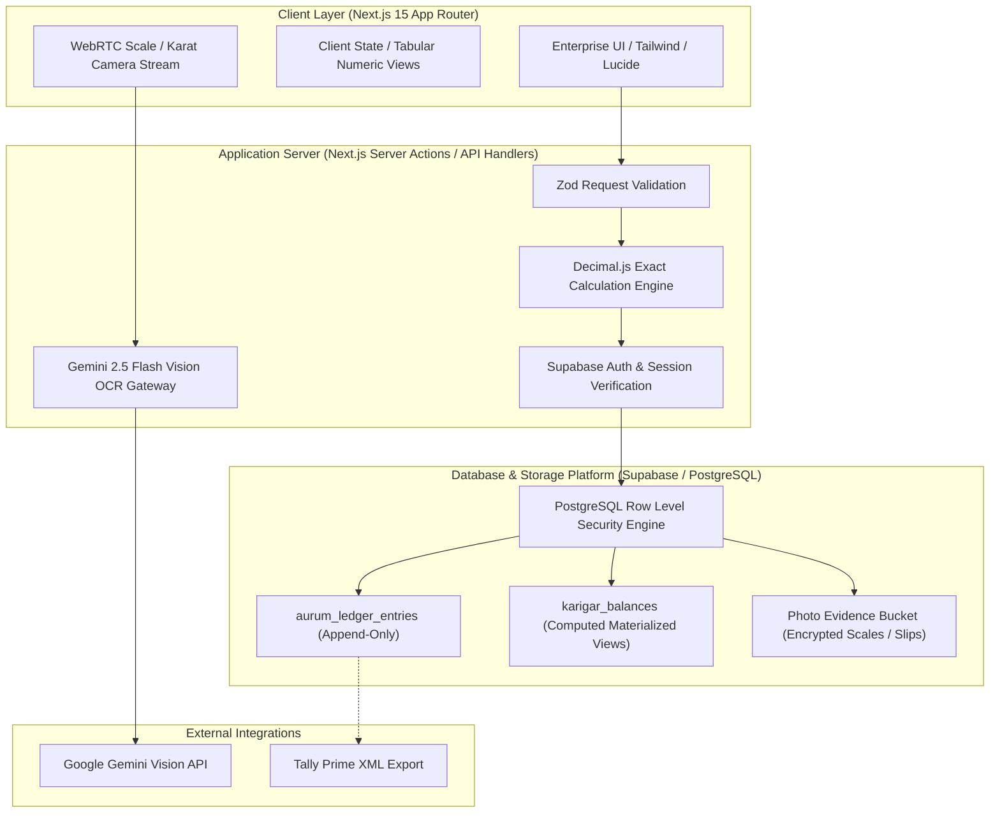
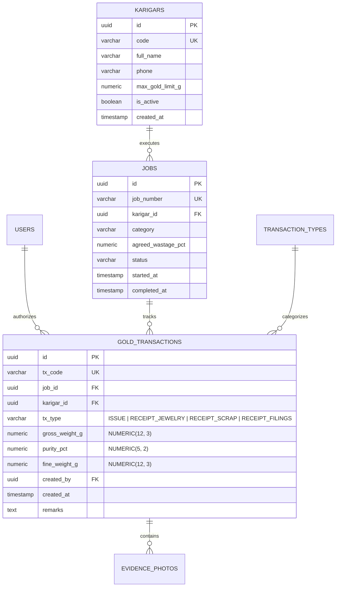
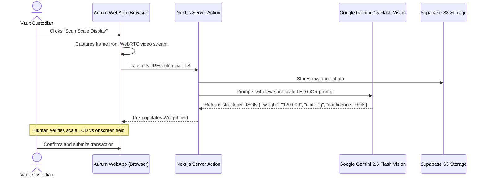

# Technical Architecture Specification

## 1. Architecture Overview
Aurum Ledger is architected as an enterprise-grade, high-integrity financial and material tracking platform. Given the high financial value of physical gold (₹240+ Cr annual throughput), the architecture emphasizes:
1. **Mathematical Infallibility:** Fixed-point arithmetic (`Decimal.js` & PostgreSQL `NUMERIC`) preventing any floating-point drift.
2. **Immutable Double-Entry Ledger:** All physical movements (Vault $\leftrightarrow$ Karigar $\leftrightarrow$ Showroom $\leftrightarrow$ Refiner) follow debit/credit gold accounting.
3. **Defense-in-Depth Security:** Multi-tenant PostgreSQL Row Level Security (RLS) with strict role-based access control.
4. **Resilient AI Boundary:** Assistive AI scale reading isolated from the core transactional write pipeline.



---

## 2. Frontend Structure & Application Architecture

The application adopts a feature-driven Next.js App Router structure inside `src/`:

```
src/
├── app/                        # Next.js App Router root
│   ├── (dashboard)/            # Authenticated application shell layout
│   │   ├── page.tsx            # Workshop Overview Dashboard (Root)
│   │   ├── karigars/           # Karigar Master Directory
│   │   ├── gold-issue/         # Gold Issuance Workflow
│   │   ├── gold-receipt/       # Multi-part Gold Returns & Receipts
│   │   ├── karigar-ledger/     # Detailed Account Statements
│   │   ├── loss-alerts/        # Unexplained Variance & Audit Alerts
│   │   ├── daily-stock/        # Daily Consolidated Vault & Bench Stock
│   │   └── old-gold/           # Customer Old Gold Intake Desk
│   ├── layout.tsx              # Root HTML layout, font setup, theme providers
│   └── globals.css             # Tailwind base & luxury CSS tokens
├── components/                 # Reusable Enterprise Component Library
│   ├── ui/                     # Primitives (Button, Card, Input, Badge, Dialog, etc.)
│   ├── layout/                 # Sidebar, Header, MobileNav, Breadcrumb
│   └── shared/                 # Business widgets (MetricCard, GramDisplay, PurityBadge)
├── lib/                        # Core Utilities & Mathematical Infrastructure
│   ├── utils.ts                # Tailwind class merger (cn)
│   ├── formatters.ts           # 3-decimal gram, 2-decimal purity, INR currency formatters
│   └── calculations.ts         # Pure gold calculations & variance detection
├── types/                      # TypeScript Global Type Definitions
│   ├── gold.ts                 # Transaction, weight, purity, and variance types
│   ├── karigar.ts              # Karigar profiles and wastage contracts
│   └── navigation.ts           # Navigation items and breadcrumb types
└── data/                       # Centralized Mock Data & Prototypes
    └── mock-data.ts            # Verified sample transactions & realistic workshop state
```

---

## 3. Database Schema Plan (PostgreSQL)

### 3.1 Immutable Ledger Design
Physical gold is tracked using an append-only transaction ledger (`gold_transactions`). Updates and hard deletions are strictly prohibited at the database level. Corrections require a corresponding reversing transaction (`REVERSAL`).



### 3.2 Key Table Specifications
- **`gold_transactions`**:
  - `gross_weight_g`: `NUMERIC(12, 3)` — strictly 3 decimal places.
  - `purity_pct`: `NUMERIC(5, 2)` — strictly 2 decimal places (e.g. 91.60).
  - `fine_weight_g`: `NUMERIC(12, 3)` — computed: `ROUND(gross_weight_g * purity_pct / 100.0, 3)`.
  - `tx_type`: Enum (`ISSUE`, `RECEIPT_FINISHED`, `RECEIPT_SCRAP`, `RECEIPT_FILINGS`, `REVERSAL`).

---

## 4. Authentication & Role-Based Permissions (RBAC)

### 4.1 Auth Engine
- Handled by **Supabase Auth** utilizing JWTs and secure HttpOnly cookies.
- Session verification executed on Next.js Server Components and Server Actions.

### 4.2 Role Permission Matrix

| Role | View Dashboard | Issue Gold | Receive Gold | Close Job | Approve Loss | Tally Export | User Admin |
| :--- | :---: | :---: | :---: | :---: | :---: | :---: | :---: |
| **Super Admin / MD** | Yes | Yes | Yes | Yes | Yes | Yes | Yes |
| **Workshop Manager** | Yes | Yes | Yes | Yes | Up to 2.000 g | Yes | No |
| **Vault Custodian** | Yes | Yes | Yes | No | No | No | No |
| **Karigar Supervisor**| Yes | Entry only | Entry only| Request | No | No | No |
| **Showroom Manager** | Limited | No | Old Gold only | No | No | No | No |
| **Karigar (Artisan)** | Own jobs | No | No | No | No | No | No |

---

## 5. AI Integration Boundary & Vision Processing



### Security & Integrity Rules:
1. **Never Automated:** An AI reading never auto-commits a transaction without explicit human confirmation.
2. **Confidence Threshold:** Readings with $<95\%$ confidence require manual re-entry.
3. **Audit Photo Persistence:** Scale photos are permanently linked to the transaction record for post-incident audits.

---

## 6. Testing & Quality Assurance Strategy

- **Unit Testing (Vitest):** Tests calculation functions, formatters, and edge cases (e.g. division remainders, negative inputs, precision rounding).
- **Component Testing (React Testing Library):** Verifies rendering, accessibility (ARIA), tabular alignment, and user interaction.
- **End-to-End Testing (Playwright - Future Phase):** Simulates end-to-end issue, receipt, and reconciliation workflows.
- **Static Analysis:** TypeScript in strict mode (`noImplicitAny`, `strictNullChecks`), ESLint, and Prettier.

---

## 7. Deployment Strategy & Environment Topology

- **Edge / Serverless:** Vercel Pro with automated CI/CD branch previews.
- **Database:** Supabase PostgreSQL located in AWS Region `ap-south-1` (Mumbai) to ensure single-digit millisecond latency to Coimbatore.
- **Zero Secrets Policy:** No secrets or private API keys stored in Git. All credentials provisioned via environment variables.
