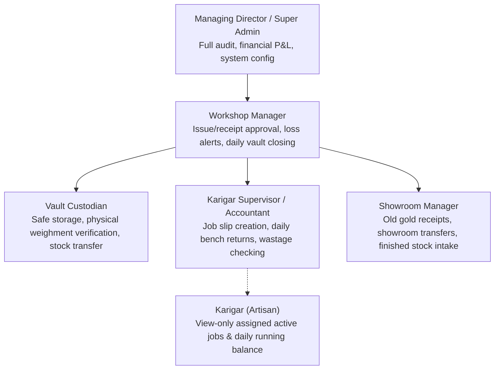
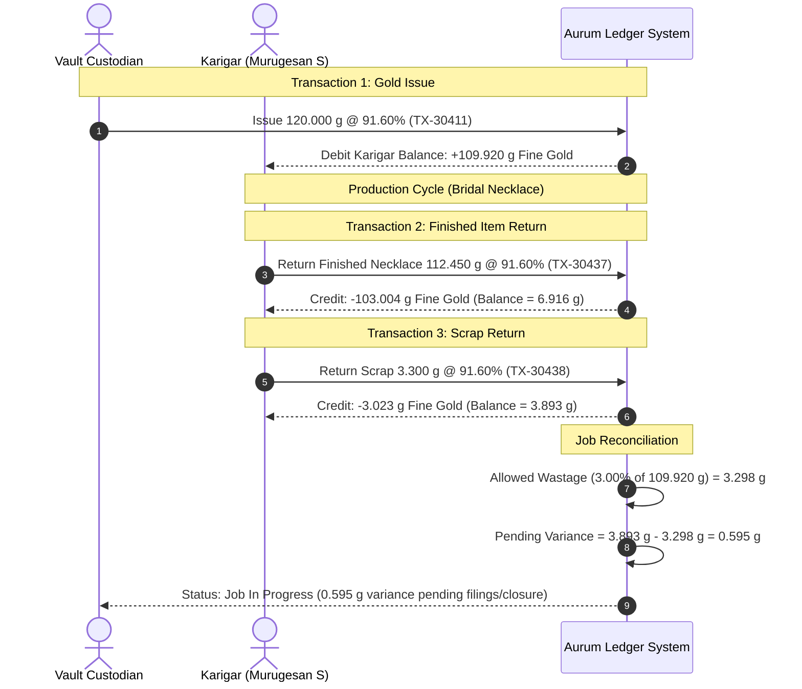

# Product Requirements Document (PRD)

## Project Overview
- **Project Name:** AURUM LEDGER
- **Subtitle:** Jewellery Workshop Gold Accountability System
- **Tagline:** *Every gram accounted for.*
- **Repository:** `https://github.com/Mehul8864/aurum-ledger`
- **Default Branch:** `main`
- **Document Version:** 1.0.0
- **Status:** Approved Architecture Draft (Prompt 1 Foundation)

---

## 1. Executive Summary & Client Background
The client is an established, high-volume retail and manufacturing jewellery enterprise headquartered in **Coimbatore, Tamil Nadu, India**—a premier jewellery manufacturing and retail hub in South India.

### Organizational Scale
- **Showrooms:** 5 retail showrooms across the Coimbatore metropolitan and western Tamil Nadu region.
- **Manufacturing Unit:** 1 centralized, high-security jewellery workshop catering to bespoke and replenishment inventory.
- **Artisan Workforce (Karigars):** Approximately 40 specialized karigars (both in-house bench artisans and job-work contractors).
- **Total Staff:** ~180 employees across workshop operations, inventory management, retail sales, security, and administrative accounting.
- **Annual Turnover:** ₹220–₹260 Crore (INR), representing an annual gold throughput of approximately 250 to 320 kilograms of fine gold.

### Current State & Problem Statement
Currently, all gold issuance, melting, crafting, returns, scrap tracking, and bench loss calculations are recorded manually using **physical paper ledgers (*Katha/Chit books*)** and disparate **Microsoft Excel spreadsheets**.

This manual operating model exhibits severe operational, financial, and compliance risks:
1. **Unaccounted Gold Leakage:** With annual gold turnover exceeding ₹240 Crore, an undetected variance of even 0.1% equates to **₹24 Lakhs** in annual leakage.
2. **Reconciliation Latency:** Reconciling physical weights with Excel spreadsheets currently takes 2 to 4 days, meaning loss or theft is detected long after karigars have completed a production cycle.
3. **Transcription & Calculation Errors:** Standard JavaScript or manual Excel floating-point calculations produce rounding errors across fine-gold conversions (gross weight $\times$ purity percentage).
4. **Wastage Ambiguity:** Contractual wastage (*Vada/Ghat*) percentages agreed with karigars vary across jewellery types (plain gold bangles vs. intricate bridal antique necklaces), leading to constant disputes during final settlement.
5. **Lack of Centralized Audit Trail:** Hand-written slips and edited spreadsheet cells lack cryptographic immutability, making internal forensic audits impossible.

---

## 2. Business & Financial Assumptions

| Parameter | Baseline Value | Impact on Gold Accountability |
| :--- | :--- | :--- |
| **Annual Jewellery Revenue** | ₹220–₹260 Crore | High-value inventory where fractional gram variances accumulate rapidly. |
| **Prevailing 24K Gold Price** | ~₹7,200 – ₹7,800 per gram | 1.000 gram of unaccounted loss = ~₹7,500 direct financial loss. |
| **Active Karigars** | 40 artisans | Requires individual balance-sheet tracking per artisan bench. |
| **Daily Issue Volume** | 1,000.000 g – 2,500.000 g | High daily transaction frequency requiring rapid entry (<30 seconds). |
| **Decimal Precision Standard** | **3 decimal places (0.001 g / 1 mg)** | Standard electronic scale precision in Indian jewellery workshops. |
| **Purity Precision Standard** | **2 decimal places (e.g., 91.60%)** | BIS Hallmarking standards (22K = 91.60%, 18K = 75.00%). |
| **Monetary Precision Standard** | **2 decimal places (INR ₹)** | Standard accounting convention in Indian Rupees. |

---

## 3. User Personas & Role-Based Access

### Roles and Responsibilities
1. **Super Admin / Managing Director:**
   - Global visibility across all 5 showrooms and workshop vault.
   - Approval of high-threshold gold loss write-offs (>5.000 g).
   - Tally export approvals and profit/loss reporting.
2. **Workshop Manager:**
   - Authorizes gold release from central vault to karigars.
   - Manages agreed wastage percentage matrices per category.
   - Investigates unexplained gold variances before job closure.
3. **Vault Custodian:**
   - Operates physical scale and karat meter.
   - Performs daily vault opening and evening 8:00 PM IST reconciliation.
   - Validates physical 24K bullion bars and recycled old gold lots.
4. **Karigar Supervisor / Accountant:**
   - Enters gold issues and daily returns (finished goods, scrap, filings/dust).
   - Monitors open job cards and running fine-gold balances.
5. **Showroom Manager:**
   - Processes customer old-gold buybacks and initiates melting/refining transit.
6. **Karigar (Artisan):**
   - Read-only access via mobile terminal to view their outstanding gold balance and active job specifications.

---

## 4. Must-Have Functional Requirements

### 4.1 Gold Issue Tracking
- Record gross weight, purity percentage, and automatically compute pure fine-gold weight.
- Issue types: Bullion Bar (24K - 99.90%), Alloyed Ingot (22K - 91.60%, 18K - 75.00%), Casting Grains, Solder/Cadmium wire.
- Mandatory Karigar selection, Job ID linkage, and scale photo upload (future AI OCR).

### 4.2 Gold Receipt & Recovery Tracking
- Multi-component returns per job card:
  1. **Finished Jewellery:** Gross weight, stone/wax weight deduction, nett weight, hallmarked purity.
  2. **Usable Scrap (*Ghat/Melting Scrap*):** Off-cuts, sprues, and clean scrap.
  3. **Bench Filings (*Tumbara/Powder*):** Workshop filings collected from bench trays.
  4. **Dust/Polish Recovery (*Sludge/Washings*):** Retained for batch chemical refining.
- System automatically reconciles running fine-gold balance against allowed wastage.

### 4.3 Agreed Wastage (*Vada*) Management
- Configurable wastage matrices based on jewellery complexity:
  - Plain casting ring/bangle: 1.50% – 2.50%
  - Handcrafted bridal necklace: 2.80% – 3.50%
  - Antique temple filigree work: 3.50% – 5.00%
- Real-time comparison: $\text{Excess Variance} = \text{Unreturned Fine Gold} - \text{Allowed Wastage}$.

### 4.4 Unexplained Gold Loss Detection & Alerting
- Real-time notification if:
  - An open job exceeds the allowed turnaround duration (e.g., >7 days).
  - Calculated excess variance exceeds tolerance threshold (>0.250 g).
  - Running karigar balance exceeds the credit limit assigned to that karigar.
- **Strict Business Rule:** An open job with outstanding gold is NEVER classified as "unexplained loss" until formal job completion and final bench cleanup audit.

### 4.5 AI Scale & Karat Meter Integration (Roadmap)
- WebRTC camera capture directly within issue/receipt dialogs.
- Automatic OCR of 7-segment LED weight displays (e.g., Sartorius/Essae scales).
- Automatic OCR of Karatmeter XRF spectral printouts.
- Mandatory two-way verification: AI detected value vs. human confirmation.

### 4.6 Old Gold Desk
- Showroom intake of customer scrap jewellery.
- Acid test / Karatmeter purity logging.
- Transit tracking from showroom to central workshop refinery.
- Melting loss verification (Pre-melt weight vs. Post-melt bar weight).

### 4.7 Stock & Vault Visibility
- Real-time 3-way stock balance:
  $$\text{Total Gold Asset} = \text{Vault Bullion} + \text{Karigar Bench Gold} + \text{Showroom Stock} + \text{Refinery Transit}$$

### 4.8 Tally-Compatible Financial Export
- Automated generation of XML/CSV journal vouchers for Tally Prime:
  - Gold Inventory Ledger (24K, 22K, 18K).
  - Karigar Job-Work Liability Ledger.
  - Manufacturing Wastage & Loss Expense Ledger.

---

## 5. Sample Transaction Walkthrough

The following verified transaction cycle represents the gold accounting standard implemented in Aurum Ledger:

### Exact Mathematical Proof:
1. **Gold Issue (TX-30411):**
   $$\text{Fine Weight} = 120.000\text{ g} \times \frac{91.60}{100} = 109.920\text{ g}$$
2. **Finished Necklace Receipt (TX-30437):**
   $$\text{Fine Weight} = 112.450\text{ g} \times \frac{91.60}{100} = 103.004\text{ g}$$
3. **Scrap Return (TX-30438):**
   $$\text{Fine Weight} = 3.300\text{ g} \times \frac{91.60}{100} = 3.023\text{ g}$$
4. **Running Fine Balance:**
   $$109.920 - 103.004 - 3.023 = 3.893\text{ g}$$
5. **Contractual Allowed Wastage (3.00% on 109.920 g):**
   $$109.920 \times \frac{3.00}{100} = 3.298\text{ g}$$
6. **Variance Pending Final Bench Filings Recovery:**
   $$3.893 - 3.298 = +0.595\text{ g}$$

---

## 6. Seven-Day Phased Delivery Roadmap (10 Prompts)

| Prompt / Phase | Scope & Milestones |
| :--- | :--- |
| **Prompt 1 (Current)** | Architecture docs, design system, luxury shell, prototype dashboard, 5 Git commits. |
| **Prompt 2** | Supabase database schema, RLS policies, migrations, typed client integration. |
| **Prompt 3** | Authentication, role permissions, protected routes, user profile management. |
| **Prompt 4** | Karigar Master directory, artisan profiles, agreed wastage contracts, KYC documents. |
| **Prompt 5** | Gold Issue module: issue forms, weighing scale integration, fine-gold calculator. |
| **Prompt 6** | Gold Receipt module: multi-part returns (jewellery, scrap, filings, dust). |
| **Prompt 7** | Karigar Ledger & reconciliation engine: real-time balance sheets, statement export. |
| **Prompt 8** | Loss detection engine: automated variance alerts, audit logs, supervisor resolution. |
| **Prompt 9** | Old Gold Desk & Vault inventory: showroom buybacks, melting batches, 5-showroom stock. |
| **Prompt 10** | Tally Prime export, reports, enterprise hardening, end-to-end testing, production deploy. |

---

## 7. Success Criteria & KPIs
- **Zero Calculation Discrepancies:** All fine-gold operations match exact `Decimal.js` fixed-point calculations down to 0.001 g.
- **Reconciliation Speed:** Daily workshop closing time reduced from 3 hours to **under 15 minutes**.
- **Audit Defensibility:** 100% of gold movements possess an immutable event record linked to an authenticated user ID and timestamp.
- **System Responsiveness:** Core dashboard and transaction tables load within <1.0s on broadband and 4G connections.
